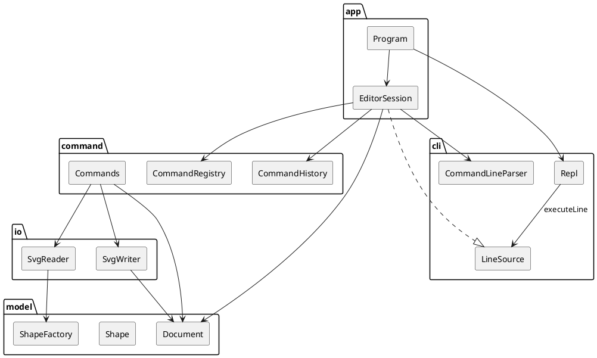

# SVG 编辑器（CLI）

本文按落地后的源码修订。命令级语义、文案和测试夹具以 `doc/实现计划.md` 为准，这里不重复规格书。

## 架构方案

Phase 1 是一个 TypeScript 面向对象的命令行编辑器：`npm run cli` 进入 `svg>`，完成规格书中的编辑会话，并把文档存成可在浏览器打开的 SVG。图形限于 rect、circle、ellipse、line、text、g。`box` 与 `ShapeProvider` 留到下一阶段，本阶段 `create box` 报未知类型。

### 模块划分

```text
src/
  model/     文档、图形、几何、树和 show 的文本、SVG 字符串
  io/        文件字节与 XML DOM。读入转换成 ElementData，写出调用 Document.toSvg()
  command/   命令、历史栈、注册表、编辑上下文接口
  cli/       拆行、引号、注释、REPL。LineSource 只声明 executeLine
  app/       组合根。EditorSession 实现编辑上下文和 LineSource，Program 启动 REPL
test/        测试代码，不参与下面的依赖规则
```

不建 `index.ts` 桶文件，依赖方向从 import 路径直接可见。一类一文件，文件名等于类名。



| 模块 | 职责 |
|---|---|
| model | 画布与图形树、按 id 索引、移动缩放与属性、树形文本、SVG 字符串 |
| io | 把 XML 文件读成 `ElementData`，并把 `Document.toSvg()` 原子写入磁盘 |
| command | 一条命令一个类；历史栈只保存命令对象 |
| cli | 提示符、注释、引号。产出命令名和参数，不执行 |
| app | 组装上述对象，是唯一的组合根 |

### 设计模式的选择

规格书要求使用命令模式，组合结构用来统一容器和叶子。类型与命令的名字映射集中在两处工厂式注册表，并标为待重构。

**命令。** 每次成功的编辑是一个命令对象。第一次 `execute` 完成校验、记下前后快照并修改文档；`undo` 恢复之前的快照；重做时再次 `execute`，恢复之后的快照，而不是把位移或缩放再做一遍。`EditorSession` 是调用者，负责入栈、出栈，以及文档命令之后锁住撤销。

一条编辑命令是一个撤销单元。`group` 一次收编多个图形，撤销一次全部还原。`init` 和 `read` 会换掉整份文档，因此清空撤销栈再上锁。`save` 和修改尺寸的 `canvas` 只上锁，保留已有的 undo 栈，下一条成功的编辑重新开锁。查询命令不进栈。

**组合。** `Shape` 是抽象类，`Group` 与 rect、circle、ellipse、line、text 都是 `Shape`。`move`、`scale`、`delete`、`set` 不在命令里区分容器和叶子。组没有自己的坐标，移动和缩放递归到每个子孙，直接改几何数值。这样 `tree` 看到的是绝对坐标，存盘文件也不依赖 `transform`。

**工厂。** `ShapeFactory` 把类型名和 SVG 标签映射到类，`CommandRegistry` 把命令名映射到类。这两处是允许的按名字分发，源码注释和本文都标为待重构：新图形、新命令应改为登记，而不是在 `CreateCommand` 或各个编辑命令里增加类型分支。写出 SVG 时每个图形类实现自己的 `appendSvg`。读入时 `SvgReader` 只问工厂要标签对应的类。

### 依赖方向规则

| 模块 | 可以依赖 | 不可以依赖 |
|---|---|---|
| model | 只依赖自己 | io、command、cli、app |
| io | model | command、cli、app |
| command | model、io | cli、app |
| cli | 无 | model、io、command、app |
| app | model、io、command、cli | — |

模型是核心，不知道文件和提示符。io 把 XML 挡在外面，更换解析方式时不改图形类。命令修改模型并调用读写。cli 只产出「命令名 + 参数」或语法错误，更换命令实现时解析器不动。app 负责把它们装到一起。

两处依赖倒置保住这张表：`EditorContext` 定义在 command，由 `EditorSession` 实现，command 不 import app；`LineSource` 定义在 cli，`Repl` 只调用 `executeLine`，由 `Program` 把会话装进去，cli 不 import app。

违反上表的 import 视为架构债，在引入时改掉。

### 变化点假设

1. **新的图形类型（下一阶段的 box）。** 留了 `ShapeFactory` 这一张表，注释标为待重构。本阶段不留 `ShapeProvider`，也不写 `data-kind`：插件阶段要求内核新增代码为 0，那是下一次的重构；这次先把类型分发收拢到一个类。`ungroup` 对复合图形的拒绝也留到那时，本阶段所有 `g` 都是普通组。
2. **新命令。** 留了 `CommandRegistry` 的手工登记表，同样标为待重构。本阶段不做成运行时插件。
3. **外部文件里的 transform、style 和新属性。** 挡在读入路径：不认识的属性警告后丢弃，模型只保存几何和 fill、stroke、stroke-width。长度上的 `px` 在交给模型之前去掉，模型只解析纯数字。每个图形类只写出自己认识的字段。
4. **撤销要记录的数据。** 历史栈只保存命令对象，不访问图形的私有字段。几何命令自己记受影响子树的字段快照，结构命令自己记父子序列。组没有坐标，所以移动一组时快照必须盖住子孙，不能只盖住组节点。
5. **第二个前端。** 留了 `EditorSession.executeLine`。REPL 只通过 `LineSource` 调用它。不为尚未出现的图形界面提前做事件总线。
6. **组的变换写成 SVG transform，还是烘焙进子节点坐标。** 选择烘焙，不为 transform 留模型字段。`scale` 的定义是去乘几何属性，`tree` 打印绝对坐标。已知代价：外部 SVG 上的 `transform` 不参与坐标计算，读入时忽略并警告。

## 过程记录

- **文档先于源码。** 用户要求先提交实现计划，再分步写代码。架构说明的初版因此按计划写成，当时还没有 import 可查。第 7 步对照落地目录重写了本文，并删去单独的过程记录文件，条目收在这一节。
- **组件图和依赖表打架。** 计划里的组件图画了 `Repl → EditorSession`，依赖表又禁止 cli 引用 app。若按图做成 import，cli 就会认识会话。改成 cli 自己声明 `LineSource`，`Program` 构造会话后交给 `Repl`。`src/cli` 的 import 只有 `node:readline` 和本目录文件。`test/cli.test.ts` 用管道喂命令，横幅与 `help` 跟规格一致。
- **管道里没有终端回车。** 非交互时，读到一行之后若不补换行，命令输出会粘在提示符那一行。`Repl` 只在非 TTY 上补这个换行，交互终端仍用回车。同一条管道测试确认输出另起一行。
- **撤销一组移动不能只快照组。** 组的字段快照只有外观，坐标在子孙上。几何命令因此记下整棵受影响子树；`undo` 恢复之前的快照，重做恢复之后的快照，位移和因子不会再乘一次。`test/model.test.ts` 确认移动组会改子孙、不改兄弟；`test/edit.test.ts` 确认重做 `move` / `scale` 不会把变化做第二遍，规格会话里的 `move c1`、`undo`、`redo` 文案逐字一致。
- **流程图期望树漏了描边。** `create line ... black` 会写入 stroke，detail 又要求已设置的外观出现，计划原稿里 `line#arrow1` 却没有 `stroke=black`。期望树补上这一段，列号仍是 32，并记入实现计划第 15 节。`test/acceptance.test.ts` 用这份文本回放第 6.1 节版本 A：`move node2 0 100` 之后矩形和文字的 y 各加 100，连线不动，撤销后回到移动前，保存结果是 8 个元素。
- **保存不能清掉更早的编辑。** `save` 和改尺寸的 `canvas` 只上锁。第 6 节会话在 `save demo.svg` 之后立刻 `undo`，得到 `error: undo not allowed after io command`。锁打开之后，更早的 `create` 仍能撤销：`create`、`save`、`move`、两次 `undo`，图形会消失。`init` 或 `read` 会换文档，这两条才会清空栈；刚 `init` 完就 `undo`，先看到 io 锁，而不是 `nothing to undo`。`test/io.test.ts` 与 `test/edit.test.ts` 锁住这几条。
- **第 6 步没有再改行为。** 两段规格会话、失败不改状态、字节往返和编组顺序都与计划一致。记入修订记录的规格偏差只有上面的 `stroke=black`。

## 一致性自查

1. **模块划分。** 实际目录是 `src/model`、`src/io`、`src/command`、`src/cli`、`src/app` 和 `test`。一类一文件，没有 `index.ts`，与方案一致。测试除 app、model 外，也直接引用了 cli 和 command（解析器、`HelpText`、`CommandHistory`）。这不改变五个源码模块的划分，已记入实现计划第 15 节。
2. **依赖方向。** 对照规则表检查了每个模块的 import，没有违反：
   - `model` 只引用本目录。
   - `io` 引用 `model`、`@xmldom/xmldom` 和 Node 的文件接口，不引用 command、cli、app。
   - `command` 引用 `model` 与 `io`（`ReadCommand`、`SaveCommand`），不引用 cli、app。
   - `cli` 只引用 `node:readline` 和本目录，不引用 model、io、command、app。
   - `app` 引用 cli、command、model。它没有直接引用 io；读写由命令完成，仍在「可以依赖 io」的范围内。

组件图已改成 `LineSource`，与这条规则一致。没有需要另记的违规 import。

## 质量保证手段

功能完整性用规格会话验收：

- `npm test` 回放规格书第 6 节和第 6.1 节版本 A（`test/acceptance.test.ts`），逐字核对成功文案、错误文案和树形输出
- 失败命令比较执行前后的树、画布尺寸、路径、undo/redo 深度和 locked（`test/edit.test.ts`、`test/hierarchy.test.ts`、`test/io.test.ts`）
- 规格书 0.1 的 SVG 做字节级比较，并做 save → read → save 的往返
- `npm run typecheck` 在严格模式下通过，源码不使用 `any`
- 手动执行 `npm run cli`，把保存出的 `.svg` 用浏览器打开
