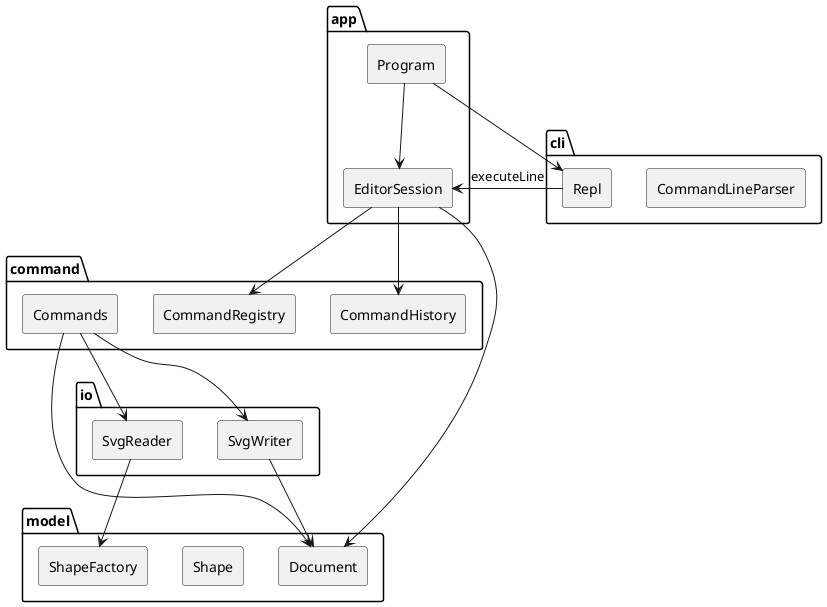

# SVG 编辑器（CLI）

本文是搭建前的架构初版，依据 `doc/实现计划.md`。源码落地后按实际目录修订。命令级语义、文案和测试夹具以实现计划为准，这里不重复规格书。

## 架构方案

Phase 1 做一个 TypeScript 面向对象的命令行编辑器：`npm run cli` 进入 `svg>`，完成规格书中的编辑会话，并把文档存成可在浏览器打开的 SVG。图形限于 rect、circle、ellipse、line、text、g。`box` 与 `ShapeProvider` 留到下一阶段，本阶段 `create box` 报未知类型。

### 模块划分

```text
src/
  model/     文档、图形、几何、树和 show 的文本、SVG 字符串
  io/        文件字节与 XML DOM。读入转换成 ElementData，写出调用 Document.toSvg()
  command/   命令、历史栈、注册表、编辑上下文接口
  cli/       拆行、引号、注释、REPL 循环
  app/       组合根。EditorSession 实现编辑上下文，Program 启动 REPL
test/        测试代码，不参与下面的依赖规则
```

不建 `index.ts` 桶文件，依赖方向从 import 路径直接可见。一类一文件，文件名等于类名。



| 模块 | 职责 |
|---|---|
| model | 画布与图形树、按 id 索引、移动缩放与属性、树形文本、SVG 字符串 |
| io | 把 XML 文件读成 `ElementData`，并把 `Document.toSvg()` 原子写入磁盘 |
| command | 一条命令一个类；历史栈只保存命令对象 |
| cli | 提示符、注释、引号。产出命令名和参数，不执行 |
| app | 组装上述对象，是唯一的组合根 |

### 设计模式的选择

规格书要求使用命令模式，组合结构用来统一容器和叶子。类型与命令的名字映射集中在两处工厂式注册表，并标为待重构。

**命令。** 每次成功的编辑是一个命令对象。第一次 `execute` 完成校验、记下前后快照并修改文档；`undo` 恢复之前的快照；重做时再次 `execute`，恢复之后的快照，而不是把位移或缩放再做一遍。`EditorSession` 是调用者，负责入栈、出栈，以及文档命令之后锁住撤销。

一条编辑命令是一个撤销单元。`group` 一次收编多个图形，撤销一次全部还原。`init` 和 `read` 会换掉整份文档，因此清空撤销栈再上锁。`save` 和修改尺寸的 `canvas` 只上锁，保留已有的 undo 栈，下一条成功的编辑重新开锁。查询命令不进栈。

**组合。** `Shape` 是抽象类，`Group` 与 rect、circle、ellipse、line、text 都是 `Shape`。`move`、`scale`、`delete`、`set` 不在命令里区分容器和叶子。组没有自己的坐标，移动和缩放递归到每个子孙，直接改几何数值。这样 `tree` 看到的是绝对坐标，存盘文件也不依赖 `transform`。

**工厂。** `ShapeFactory` 把类型名和 SVG 标签映射到类，`CommandRegistry` 把命令名映射到类。这两处是允许的按名字分发，源码注释和本文都标为待重构：新图形、新命令应改为登记，而不是在 `CreateCommand` 或各个编辑命令里增加类型分支。写出 SVG 时每个图形类实现自己的 `appendSvg`。

### 依赖方向规则

| 模块 | 可以依赖 | 不可以依赖 |
|---|---|---|
| model | 只依赖自己 | io、command、cli、app |
| io | model | command、cli、app |
| command | model、io | cli、app |
| cli | 无 | model、io、command、app |
| app | model、io、command、cli | — |

模型是核心，不知道文件和提示符。io 把 XML 挡在外面，更换解析方式时不改图形类。命令修改模型并调用读写。cli 只产出「命令名 + 参数」或语法错误，更换命令实现时解析器不动。app 负责把它们装到一起。

`EditorContext` 接口定义在 command，由 app 的 `EditorSession` 实现。command 因此不 import app。

违反上表的 import 视为架构债，在引入时改掉。

### 变化点假设

1. **新的图形类型（下一阶段的 box）。** 扩展点是 `ShapeFactory`。本阶段不预留 `ShapeProvider`，也不写 `data-kind`。插件阶段要求内核新增代码为 0，那是下一次的重构；这次先把类型分发收拢到一个类。`ungroup` 对复合图形的拒绝也留到那时，本阶段所有 `g` 都是普通组。
2. **新命令。** 扩展点是 `CommandRegistry`，同样标为待重构。本阶段手工登记。
3. **外部文件里的 transform、style 和新属性。** 挡在读入路径：不认识的属性警告后丢弃，模型只保存几何和 fill、stroke、stroke-width。每个图形类只写出自己认识的字段。
4. **撤销要记录的数据。** 历史栈只保存命令对象。几何命令自己记字段快照，结构命令自己记父子序列。栈不访问图形的私有字段。
5. **第二个前端。** REPL 只调用 `EditorSession.executeLine`。不为尚未出现的图形界面提前做事件总线。
6. **组的变换写成 SVG transform，还是烘焙进子节点坐标。** 选择烘焙。`scale` 的定义是去乘几何属性，`tree` 打印绝对坐标。已知代价：外部 SVG 上的 `transform` 不参与坐标计算，读入时忽略并警告。

## 过程记录

详细条目写在 [`过程记录.md`](过程记录.md)。

- 2026-10-20：要求先写出实现计划，再按计划分步搭建。本文是该计划的架构初版，此时还没有源码。

## 一致性自查

1. **模块划分。** 目标目录就是上文的 `model`、`io`、`command`、`cli`、`app`。源码尚未创建，没有偏离方案的目录。
2. **依赖方向。** 规则即上一节的表。尚无 import 可抽样；写代码时按该表执行，源码完成后对照每个模块的 import 再查一次。

## 质量保证手段

功能完整性用规格会话验收，而不是只看个别命令能跑：

- `npm test` 回放规格书第 6 节和第 6.1 节版本 A，逐字核对成功文案、错误文案和树形输出
- 每一类失败命令都比较执行前后的文档、路径和撤销栈，确认失败不改变状态
- 规格书 0.1 的 SVG 做字节级比较，并做 save → read → save 的往返
- `npm run typecheck` 在严格模式下通过
- 手动执行 `npm run cli`，把保存出的 `.svg` 用浏览器打开
