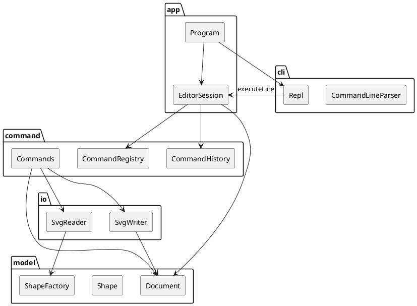

# Lab1 Phase 1 实现计划

日期：2026-10-20

本文指导 SVG 命令行编辑器的搭建。规格来源是仓库根目录的 `phase_cli_1.md`。规格书写死的语句以规格书为准；规格书没写死、但实现时必须二选一的地方，以本文第 3 节为准。代码与本文冲突时，先改第 15 节修订记录，再改代码。

文档初稿已作为第一次提交。源码尚未开始，按第 13 节从第 1 步搭建。

## 1. 使用方式

1. 实现时按第 13 节的顺序做，一步能单独运行、单独验证。
2. 第 3 节的决定不再重新讨论，除非某条规格会话对不上，那时以规格书样例为准，并写下修订。
3. 用户可见的命令输出使用规格书里的英文文案，不翻译成中文。
4. `doc/README.md` 已按第 5 节写了初版。代码落地后按实际目录修订该文件，不要把本文改名为 README。过程中的讨论记在 `doc/过程记录.md`。

## 2. 目标与边界

做成一个 TypeScript 面向对象的 REPL：`npm run cli` 出现 `svg>`，能完成规格书第 6 节和第 6.1 节版本 A 的会话，并把结果存成浏览器能打开的 SVG。

本阶段要有的能力：

- 文档：`init`、`read`、`save`、`canvas`
- 六种图形：`rect`、`circle`、`ellipse`、`line`、`text`、`g`
- 编辑：`create`、`delete`、`move`、`scale`、`set`、`group`、`ungroup`、`addto`、`front`、`back`
- 显示：`tree`、`show`、`help`
- 撤销与重做，且一条编辑命令是一个撤销单元

本阶段不做：

- `box` 与 `ShapeProvider`。`create box` 报未知类型
- 用 SVG `transform` 表示移动或缩放
- 图形界面、路径寻址、CSS `style` 的解释
- 把命令或图形合成少数几个大文件

范式约束（规格书 2.1，实现时遵守）：

- 一类一文件，文件名等于类名
- 字段封装在对象里，操作靠多态
- 按名字分发只留两处：命令注册表、图形工厂。两处都在源码注释和最终 README 里标成待重构
- 容器和叶子接受同一套 `move` / `scale` / `set` / `delete`

## 3. 已定语义

这些是规格书没写死、或样例之间不完全一致的点。

| 议题 | 决定 |
|---|---|
| 移动和缩放如何作用于 `<g>` | 递归改每个子孙的几何数值。不写 `transform`。组自己没有坐标 |
| 为什么不用 transform | `scale` 的定义是去乘几何属性；`tree` 打印绝对坐标；这样存盘后的文件不依赖变换。带 `transform` 的外部文件在读入时忽略该属性并警告 |
| `scale` 对文字 | 只乘 `x`、`y`。`font-size` 不在属性白名单里 |
| `group` 的成员顺序 | 按文档先序，不按参数书写顺序 |
| `group` 的插入位置 | 新组放在「文档顺序里第一个成员」的父节点上，占据该成员原来的下标。其他成员从各自的父节点摘出。因此成员可以本来不在同一个父节点下 |
| `group` 最少几个成员 | 至少 2 个。更少则报 usage |
| 组与其子孙同时出现在 `group` 参数里 | `error: cannot group a container into its own descendant: <容器id>`。报的是那个容器，与规格书样例 `markers` 一致 |
| `addto` 把容器放进自己的子孙 | `error: cannot add a container into its own descendant: <被移动的id>`。规格书没有这句，但没有它树会成环 |
| `ungroup` 直接挂在 svg 下的组 | 拒绝，文案按规格书 |
| `front` / `back` | 只调整同一父节点下的顺序。SVG 后绘制的在上层，所以 `front` 移到同级末尾，`back` 移到同级开头 |
| 文档命令之后的撤销 | `save` 和修改尺寸的 `canvas` 只上锁，不清空 undo 栈。下一条成功的编辑命令开锁，开锁后原来的编辑仍可继续撤销。`init` 和 `read` 会换掉整份文档，因此先清空两条栈再上锁 |
| 刚执行完 `init` 就 `undo` | 锁优先于空栈，报 `undo not allowed after io command`，不报 `nothing to undo` |
| `canvas` 不带参数 | 只查询，不上锁 |
| 读入缺 id | 按文档先序，用 `标签名 + 序号`，序号从 1 起，碰到已占用的就继续加。警告文案与规格书一致 |
| 读入不认识的标签 | 整次 `read` 失败，原文档保持不变 |
| 读入不认识的属性 | 警告并丢弃，读入仍然成功。不解释 `style` 和 `transform` |
| 失败的命令 | 不改文档、不改历史栈、不改当前路径。`read` / `save` 先在旁路完成，成功后再提交 |
| 错误输出流 | 全部写到 stdout，保证顺序和规格会话一致 |
| `tree` 的空格 | 用第 9 节的列对齐算法。第 6 节第一棵树和 `other.svg` 那棵树与算法一致，测试逐字比较。第 6.1 节流程图的空格是手排的，测试比较本文给出的算法结果，不比较规格书里的空格 |
| 数字打印 | 有限小数，去掉二进制尾数；`-0` 印成 `0`；整数值不带小数点 |
| 几何是否拒绝 0 和负数 | 不拒绝。只有 `scale` 的因子必须 `> 0`，画布宽高必须 `> 0` |
| 重做 | 恢复该命令执行后的快照，禁止把相对位移或缩放再做一遍 |

## 4. 工程

Node 20 及以上。依赖只留运行时需要的 XML 解析器，开发依赖用于跑 TypeScript。

`package.json`：

```json
{
  "name": "svg-editor",
  "version": "0.1.0",
  "private": true,
  "type": "module",
  "scripts": {
    "cli": "tsx src/app/Program.ts",
    "test": "tsx --test test/**/*.test.ts",
    "typecheck": "tsc --noEmit"
  },
  "dependencies": {
    "@xmldom/xmldom": "^0.9.8"
  },
  "devDependencies": {
    "@types/node": "^22.0.0",
    "tsx": "^4.19.0",
    "typescript": "^5.6.0"
  }
}
```

`tsconfig.json`：

```json
{
  "compilerOptions": {
    "target": "ES2022",
    "module": "ESNext",
    "moduleResolution": "Bundler",
    "strict": true,
    "noEmit": true,
    "skipLibCheck": true,
    "types": ["node"],
    "forceConsistentCasingInFileNames": true,
    "noImplicitOverride": true
  },
  "include": ["src", "test"]
}
```

`.gitignore`：`node_modules/`、`dist/`。测试用的 `.svg` 夹具要提交，不要忽略。

模块解析用 Bundler，import 不写 `.js` 后缀。`lib` 不要带 DOM，这样模型里的类可以叫 `Text`。

启动横幅与规格书一致，破折号是 U+2014：

```text
svg-editor 0.1 — type 'help' for commands

```

横幅之后空一行，再进入 `svg>`。提示符写在每行输入之前，命令输出另起行。空行和注释不产生输出。stdin 结束时进程以 0 退出。不提供 `exit` 命令，输入 `exit` 就是未知命令。

## 5. 架构草案

最终 `doc/README.md` 的架构部分从这里改写，并按落地后的目录核对。

### 5.1 模块

```text
src/
  model/     文档、图形、几何、树和 show 的文本、SVG 字符串
  io/        文件字节与 XML DOM。读入转换成 ElementData，写出调用 Document.toSvg()
  command/   命令、历史栈、注册表、编辑上下文接口
  cli/       拆行、引号、注释、REPL 循环
  app/       组合根。EditorSession 实现编辑上下文，Program 启动 REPL
test/        只依赖 app 与 model，不参与下面的依赖规则
```

不建 `index.ts` 桶文件。依赖方向要能从 import 路径直接看出来。



### 5.2 设计模式

**命令。** 每次成功的编辑是一个命令对象。对象在第一次 `execute` 里完成校验、记录前后快照并修改文档；`undo` 恢复之前的快照；再次 `execute`（重做）恢复之后的快照。`EditorSession` 是调用者，负责入栈、出栈和文档命令后的上锁。

**组合。** `Shape` 是抽象类，`Group` 与叶子都是 `Shape`。`move`、`scale`、`delete`、`set` 不在命令里区分容器和叶子。组的 `move` / `scale` 递归到子孙，叶子实现自己的几何。

**工厂。** `ShapeFactory` 把类型名和 SVG 标签映射到类。`CommandRegistry` 把命令名映射到类。这两处是允许的按名字分发，注释写明待重构：

```typescript
// 待重构：命令名到命令类的映射是本系统仅有的两处按名字分发之一。
// 新命令目前要改这个表；后续若要插件化，应改为登记，而不是继续加分支。
```

```typescript
// 待重构：类型名到图形类的映射是另一处按名字分发。
// box 一类的图形插件应替换这里，而不是在 CreateCommand 里判断类型。
```

`CreateCommand`、`MoveCommand`、`SvgWriter`、`TreeCommand` 里不能出现类型字符串分支，也不能 `switch (shape.typeName)`。写出 SVG 时每个图形类实现自己的 `appendSvg`。读入时 `SvgReader` 只处理文件、根节点、缺 id 和不认识的标签；标签到类的映射留在工厂里。

### 5.3 依赖方向

| 模块 | 可以依赖 | 不可以依赖 |
|---|---|---|
| model | 只依赖自己 | io、command、cli、app |
| io | model | command、cli、app |
| command | model、io | cli、app |
| cli | 无 | model、io、command、app |
| app | model、io、command、cli | — |

理由：模型是核心，不知道文件和命令行。io 把 XML 挡在外面，换解析方式时不改图形类。命令修改模型并调用读写，但不知道提示符。cli 只产出「命令名 + 参数」或语法错误，所以换一套命令实现时解析器不用动。app 是唯一组装这些对象的地方。

违反上表的 import 就是架构债，实现时直接改掉，不要留到最后。

`EditorContext` 接口定义在 command，由 app 里的 `EditorSession` 实现。这是依赖倒置，command 仍然不 import app。

### 5.4 变化点

1. **新的图形类型（下一阶段的 box）。** 扩展点就是 `ShapeFactory` 那张表。本阶段不预留 `ShapeProvider` 接口，也不做 `data-kind`。插件阶段的目标是内核新增代码为 0，那是下一次的重构；这次先把类型分发收拢到一个类，避免散落在命令里。`ungroup` 对复合图形的拒绝也留到那时，本阶段所有 `g` 都是普通组。
2. **新命令。** 扩展点是 `CommandRegistry`。同样标为待重构，本阶段用手工登记。
3. **文件里出现 transform、style、新属性。** 变化被挡在读入路径：不认识的属性警告后丢弃，模型只保存第 6 节列出的字段。写出时每个类只写自己认识的字段。
4. **撤销里要记的信息。** 历史栈只保存命令对象。几何命令自己记字段快照，结构命令自己记父子序列。栈不访问图形私有字段。
5. **第二个前端。** REPL 只调用 `EditorSession.executeLine`。不为此提前做事件总线。
6. **组的变换用 transform 还是烘焙进坐标。** 选择烘焙，理由见第 3 节。已知代价：外部 SVG 上的 `transform` 不会参与坐标计算。

## 6. 模型

### 6.1 文件

| 类 | 文件 | 职责 |
|---|---|---|
| `ModelError` | `model/ModelError.ts` | 模型抛出的用户可见错误，`message` 不含 `error:` 前缀 |
| `NumberText` | `model/NumberText.ts` | 解析和打印数字 |
| `XmlText` | `model/XmlText.ts` | 属性与文本的 XML 转义 |
| `ElementData` | `model/ElementData.ts` | 读入边界上的值对象：标签、按顺序的属性、文本、子元素。没有领域行为 |
| `Shape` | `model/Shape.ts` | 抽象图形：id、父指针、标签、几何、属性、SVG 片段、显示片段 |
| `Group` | `model/Group.ts` | 子节点序列。`typeName` 为 `g` |
| `Rect` `Circle` `Ellipse` `Line` `Text` | 各自文件 | 叶子 |
| `Document` | `model/Document.ts` | 聚合根：画布尺寸、根子节点、id 索引、结构变更、`toSvg`、`renderTree`、`renderShow` |
| `ShapeFactory` | `model/ShapeFactory.ts` | 类型名 / 标签名 → 类 |
| `TreeNode` | `model/TreeNode.ts` | 给对齐算法用的值对象 |
| `TreeText` | `model/TreeText.ts` | 前缀和列对齐，不知道具体图形类 |

不建 `util.ts`。共享逻辑放在上面这些类的方法里。

### 6.2 父子关系

`Shape.parent` 的类型是 `Group | Document | null`。

- `Document`：这个图形是 svg 的直接子节点
- `Group`：嵌在该组里
- `null`：不在当前文档中（例如被删除后躺在撤销快照里）

被摘下的组，其内部孩子的 `parent` 仍指向该组。id 索引只收录从 `Document` 能走到的节点，所以游离子树不占用 id。

`show` 和删除撤销里的父级名称：父级是 `Group` 时用 `g#id` 这种标签；父级是 `Document` 时用 `svg`。

结构变更只有 `Document` 的方法：

- `insert(parent: Document | Group, shape: Shape, index: number)`：shape 必须当前无父。插入后重建索引
- `detach(shape: Shape)`：从父节点摘下，`parent` 置空，重建索引。组内部的孩子指针不动
- `captureStructure()` / `restoreStructure(snapshot)`：记下或写回根以及每个组的子节点数组（存的是对象引用，不克隆图形），并写回每个节点的 `parent`，然后重建索引

每次结构变更结束都全量重建 `Map<string, Shape>`。文档规模是命令行编辑器，正确性优先。

id 大小写敏感，全局唯一，包含嵌套节点。

`allocateId(tag)`：从 `${tag}1` 开始，已被索引占用就加一。

`elementCount()`：先序遍历的节点数，不含 svg 根。`save` / `read` 的 “N elements” 用这个数。

### 6.3 图形字段

公共外观属性，五种叶子和组都有，未设置时为「无」而不是默认黑色：

- `fill?: string`
- `stroke?: string`
- `strokeWidth?: number`（写出时属性名是 `stroke-width`）

几何：

| 类 | 字段 |
|---|---|
| Rect | `x` `y` `width` `height` |
| Circle | `cx` `cy` `r` |
| Ellipse | `cx` `cy` `rx` `ry` |
| Line | `x1` `y1` `x2` `y2` |
| Text | `x` `y` `content` |
| Group | 无几何，只有子节点和可选外观 |

`move(dx, dy)`：

- 叶子改自己的位置字段（线的四个坐标都加）
- 组对每个子节点调用 `move`，组自身字段不变

`scale(factor)`：调用方保证 `factor > 0`。

- Rect：`x,y,width,height` 都乘
- Circle：`cx,cy,r`
- Ellipse：`cx,cy,rx,ry`
- Line：四个端点
- Text：`x,y`。不乘字号，内容不变
- Group：递归，不给组增加几何

`set` 白名单：

| 类 | 可设置 |
|---|---|
| rect | `x` `y` `width` `height` `fill` `stroke` `stroke-width` |
| circle | `cx` `cy` `r` `fill` `stroke` `stroke-width` |
| ellipse | `cx` `cy` `rx` `ry` `fill` `stroke` `stroke-width` |
| line | `x1` `y1` `x2` `y2` `fill` `stroke` `stroke-width` |
| text | `x` `y` `text` `fill` `stroke` `stroke-width` |
| g | `fill` `stroke` `stroke-width` |

名字大小写敏感，`Fill` 是未知属性。几何和 `stroke-width` 的值必须是有限数字，否则 `ModelError("invalid number: <原文>")`。`fill`、`stroke`、`text` 按字符串保存，允许空字符串。`text` 写的是文本内容，不是 XML 属性。

未知属性：`ModelError("unknown attribute: <attr>")`。

每个类提供 `captureFields()` 与 `restoreFields()`，只包含自己的几何和外观，不含 `parent` 和子节点。移动、缩放、`set` 用它做快照。

### 6.4 工厂

`ShapeFactory` 登记六个类。对外两个操作：

- `create(type, id, params): Shape`。`params` 不含 `in` 子句。类型未知时由命令报未知类型，工厂也可以再挡一层。参数个数不对时抛 `ModelError`，消息是该类型的 usage 字符串（见第 11 节，含 `error:` 前缀的那一半，即 `usage: ...`）
- `createFromElement(element, id): { shape: Shape, consumed: ReadonlySet<string> }`。`consumed` 是这个标签认识的属性名（不含 `id`）。不认识的标签抛 `ModelError("unsupported element: <tag>")`

参数规则：

| 类型 | params |
|---|---|
| rect | 4 个数，或 4 个数加 1 个 fill |
| circle | 3 个数，或加 fill |
| ellipse | 4 个数，或加 fill |
| line | 4 个数，或加 stroke |
| text | `x` `y` `content`，content 必填，create 时没有可选 fill |
| g | 空 |

缺省的 fill / stroke 不写入对象，也不写入 SVG。

### 6.5 数字

`NumberText.parse`：`Number(token)`，非有限数则 `invalid number`。空串失败。

`NumberText.format`：先按 1e8 四舍五入消去二进制尾数，`-0` 印成 `0`，再用十进制字符串。`100` 印成 `100`，`0.5` 印成 `0.5`。

## 7. 命令与历史

### 7.1 类型

`Command`（`command/Command.ts`）抽象类：

- `needsDocument`：默认 `true`。`InitCommand`、`ReadCommand`、`HelpCommand` 为 `false`
- `meta`：`"undo" | "redo" | null`，默认 `null`
- `assertUsage(): void`：只检查参数个数和形状，不碰文档
- `execute(ctx): CommandResult`：校验并修改。一旦写入文档，就必须正常返回

`CommandResult`：

- `message: string`
- `warnings: readonly string[]`
- `effect: "record" | "reset" | "lock" | "none"`

`CommandError` 的 `message` 同样不含 `error:` 前缀。

`EditorContext`：

- `document: Document | null`
- `filePath: string | null`（用户当初输入的路径字符串，不是绝对路径）
- `replaceDocument(document, filePath)`
- `setFilePath(filePath)`
- `resolvePath(input): string`（相对当前工作目录）

### 7.2 EditorSession.executeLine

```text
parsed = parser.parse(line)
若 parsed 为空：返回 []
command = registry.create(parsed.name, parsed.args)     // 未知命令在这里失败
若 command.needsDocument 且没有文档：
    失败 "no document. use 'init' or 'read' first"
command.assertUsage()
若 meta 为 undo：返回 history.undo 的一行
若 meta 为 redo：返回 history.redo 的一行
result = command.execute(ctx)                            // 失败则历史不动
history.apply(result.effect, command)
返回 [...warnings, message]
```

捕获 `CommandError` 和 `ModelError`，输出一行 `error: ` 加 message。其它异常不吞掉。

这个顺序要固定，测试依赖它：没文档时 `move` 报 no document，而不是 usage；没文档时 `foobar` 报未知命令；`help` 不需要文档。

### 7.3 CommandHistory

- `undoStack`、`redoStack`、`locked`
- `apply("record", command)`：压入 undo，清空 redo，`locked = false`
- `apply("reset")`：两条栈都清空，然后上锁。给 `init` / `read`
- `apply("lock")`：上锁并清空 redo，保留 undo。给 `save` 和修改尺寸的 `canvas`
- `apply("none")`：不动
- `undo`：若 locked，抛 `undo not allowed after io command`；再若栈空，抛 `nothing to undo`；否则弹出，调用 `command.undo`，压入 redo
- `redo`：同样先看锁，空栈抛 `nothing to redo`；调用该命令的 `execute`（第二次），压回 undo

`UndoCommand.execute` 不应被调用。撤销的工作对象是栈本身。

### 7.4 快照契约

这是最容易写错的地方。

第一次 `execute`：

1. 完整校验，此时文档还是原样
2. 记录「之前」
3. 修改文档
4. 记录「之后」
5. 标记已执行并返回正向文案

`undo` 恢复「之前」。再次 `execute` 恢复「之后」，不要把 `dx` 或缩放因子再应用一次。

几何命令（`move`、`scale`、`set`）的快照是受影响节点的 `captureFields()`。组操作要覆盖整棵子树。

结构命令（`create`、`delete`、`group`、`ungroup`、`addto`、`front`、`back`）的快照是 `Document.captureStructure()`。这些命令不改几何，恢复结构即可。新创建的图形对象由命令字段持有，这样它在被摘下后仍活在快照里。

`init` / `read` 替换文档对象后，旧命令里的引用全部失效，所以它们的 effect 必须是 `reset`，不能只上锁。

编辑命令的 effect 是 `record`。查询类是 `none`。

### 7.5 注册表

`CommandRegistry.create(name, args)` 用一张手写表把名字映射到类。名字全小写，大小写不一致就是未知命令：`error: unknown command: <name>`。

登记的名字只有：`init` `read` `save` `canvas` `create` `delete` `move` `scale` `set` `group` `ungroup` `addto` `front` `back` `tree` `show` `help` `undo` `redo`。

## 8. 解析

`CommandLineParser.parse(line)` 返回 `ParsedLine` 或 `null`。`null` 表示空行，或去掉首尾空白后以 `#` 开头的注释。`#` 只有在这一位置才是注释，颜色 `#4a90d9` 是普通参数。

拆词规则：

- 分隔符是空格和 Tab
- 双引号内是一个参数，引号本身不进入参数
- 本阶段没有转义。引号内再出现 `"` 就结束字符串
- 引号未闭合：由 parser 返回错误 `unclosed quote`（session 加上 `error:` 前缀）。这是语法错误，不进入命令
- 引号可以出现在行中间，文本 `"My Diagram"` 是一个参数

`ParsedLine` 只有 `name` 和 `args`。

`create` 的 `in` 子句不在解析器里识别，由 `CreateCommand` 处理：若参数至少两个且倒数第二个是单独的 `in`，则最后一项是容器 id，其余才是类型参数。因此：

- `create text t 10 20 "in"` 的内容是 `in`，没有容器
- `create text t 10 20 "hello" in node1` 挂到 `node1`
- `create line a 0 0 1 1 in` 的 stroke 是 `in`，因为后面没有容器 id

## 9. 显示

### 9.1 tree

根行：`svg (宽x高)`，宽高用 `NumberText.format`。`tree <id>` 不以 svg 为根，第一行是该节点自己的标签，没有枝杈前缀。

枝杈：

- 非最后子节点：`├── `
- 最后子节点：`└── `
- 继续往下时，父节点不是最后子节点用 `│   `，是最后子节点用四个空格
- 这四字符的片段逐级相加

每个节点的标签是 `type#id`，例如 `rect#bg`、`g#markers`、`text#start-label`。

属性区 `detail` 为空时，这一行只有前缀加标签，不加尾部空格。组默认没有 detail；若组自己有外观属性，则跟上外观。

detail 的格式：

| 类型 | detail |
|---|---|
| rect | `x=0 y=0 w=800 h=600`，有则再加 ` fill=...` ` stroke=...` ` stroke-width=...`。宽高在树上用 `w` `h` |
| circle | `cx=100 cy=100 r=20`，再加已设置的外观 |
| ellipse | `cx=1 cy=2 rx=3 ry=4`，再加外观 |
| line | `(280,130) -> (520,130)`，再加外观 |
| text | `(20,40) "内容"`，再加外观。内容里的 `\` 和 `"` 在显示时转义 |
| g | 仅外观；都没有就是空串 |

外观顺序固定为 fill、stroke、stroke-width，未设置的不出现。

列对齐，整棵要打印的树共用一个列号：

```text
column = max(前缀长度 + 标签长度) + 2
```

只统计 detail 非空的行。该行空格数 = `column - 前缀长度 - 标签长度`。因此最长的那一行恰好两个空格，其余属性起始列相同。

第 6 节第一棵树的列号是 19，下面这段必须逐字相等（含空格）：

```text
svg (800x600)
├── rect#bg        x=0 y=0 w=800 h=600 fill=#ffffff
├── text#title     (20,40) "My Diagram"
└── g#markers
    ├── circle#c1  cx=100 cy=100 r=20 fill=red
    └── rect#box   x=200 y=80 w=60 h=60 fill=#3366ff
```

`other.svg` 读入后的树也逐字相等：

```text
svg (400x300)
├── rect#rect1     x=0 y=0 w=400 h=300 fill=#ffffff
├── text#t1        (10,290) "imported"
├── circle#c1      cx=50 cy=50 r=10
├── g#g1
│   ├── rect#r2    x=0 y=0 w=10 h=10
│   └── circle#c2  cx=5 cy=5 r=2
└── ellipse#e1     cx=1 cy=2 rx=3 ry=4
```

第 6.1 节流程图按同一算法，列号是 32，期望文本是：

```text
svg (800x600)
└── g#flowchart
    ├── g#node1
    │   ├── rect#start          x=120 y=100 w=160 h=60 fill=#4a90d9
    │   └── text#start-label    (155,135) "开始"
    ├── g#node2
    │   ├── rect#process        x=520 y=100 w=160 h=60 fill=#f5a623
    │   └── text#process-label  (545,135) "处理数据"
    └── line#arrow1             (280,130) -> (520,130) stroke=black
```

`move node2 0 100` 之后，`process` 的 y 变为 200，`process-label` 的 y 变为 235，线不动。这是「烘焙进坐标」的验收点。撤销后坐标回到移动前。

`tree <id>` 只打印以该节点为根的子树。id 不存在报 `no such shape`。

### 9.2 show

```text
circle#c1  parent=g#markers
  cx=100 cy=100 r=20
  fill=red
```

首行是标签、两个空格、`parent=svg` 或 `parent=g#id`。后续行缩进两个空格。

- 叶子先打几何，用全名：`width` `height`，不用 `w` `h`
- 文字再打一行 `text="内容"`
- 组打一行 `children=<个数>`
- 最后一行是已设置的外观，顺序与 tree 相同；都没有则省略这一行

### 9.3 help

`HelpText` 放在 command 模块，避免 command 去依赖 cli。正文固定为：

```text
init [w] [h]                              create a canvas (default 800x600)
read <file.svg>                           load an SVG file
save [file.svg]                           save the document
canvas [w] [h]                            show or resize the canvas
create <type> <id> [params...] [in <id>]  create a shape
delete <id>                               delete a shape
move <id> <dx> <dy>                       move by a delta
scale <id> <factor>                       scale geometry by a positive factor
set <id> <attr> <value>                   set an attribute
group <newGid> <id1> <id2>...             group existing shapes
ungroup <gid>                             dissolve a nested group
addto <gid> <id>                          move a shape into a group
front <id>                                bring to front within the parent
back <id>                                 send to back within the parent
tree [id]                                 print the structure tree
show <id>                                 print one shape
help                                      show this help
undo                                      undo the last edit
redo                                      redo the last undone edit
```

## 10. 读写

### 10.1 写出

`Document.toSvg()` 在 model 里，每个图形类写自己的标签。`SvgWriter` 只做原子写文件：写入同目录临时文件，再 `rename` 覆盖目标。失败时删除临时文件，磁盘上的旧文件和内存文档都保持原样，历史不上锁。

格式：

- 首行 `<?xml version="1.0" encoding="UTF-8"?>`
- 根元素带 `xmlns="http://www.w3.org/2000/svg"`、`width`、`height`、`viewBox="0 0 宽 高"`
- 缩进两个空格，换行用 LF，文件末尾有一个换行
- 无子节点的标签写成 `<rect .../>`，斜杠前没有空格
- 空组写成 `<g id="scene"/>`
- svg 根始终成对出现。没有子节点时开标签和闭标签各占一行
- 文本内容转义 `& < >`。属性值用双引号并转义 `& < > "`
- 未设置的 fill、stroke、stroke-width 不写
- 属性顺序：`id`，然后几何，然后 fill、stroke、stroke-width

几何属性顺序：rect 为 `x y width height`；circle 为 `cx cy r`；ellipse 为 `cx cy rx ry`；line 为 `x1 y1 x2 y2`；text 为 `x y`，内容是元素文本。

规格书 0.1 的最小文件是字节级夹具。下面的命令序列写出的文件应与该 XML 一致，并在 `</svg>` 后多一个换行：

```text
init 400 200
create g flow
create rect start 30 70 120 60 #4a90d9 in flow
create line edge 150 100 250 100 black in flow
create rect end 250 70 120 60 #f5a623 in flow
```

期望：

```xml
<?xml version="1.0" encoding="UTF-8"?>
<svg xmlns="http://www.w3.org/2000/svg" width="400" height="200" viewBox="0 0 400 200">
  <g id="flow">
    <rect id="start" x="30" y="70" width="120" height="60" fill="#4a90d9"/>
    <line id="edge" x1="150" y1="100" x2="250" y2="100" stroke="black"/>
    <rect id="end" x="250" y="70" width="120" height="60" fill="#f5a623"/>
  </g>
</svg>
```

再读入并再次保存，字节应相同。

数值 `10.0` 读入后再保存写成 `10`。这是既定行为。

### 10.2 读入

`SvgReader` 使用 `@xmldom/xmldom`，把 DOM 转成 `ElementData` 后再交给工厂。xmldom 的类型和 API 不得泄漏到 model。

规则：

- 根标签必须是 `svg`，否则 `invalid svg: root element is not svg`
- 宽高取 `width` / `height`。缺了再看 `viewBox` 的第 3、4 个数。仍没有则 `invalid svg: missing canvas size`
- 长度可以带后缀 `px`，去掉后再解析。其它单位 `invalid svg: unsupported length: <原文>`
- 忽略注释和标签之间的空白文本
- 先序遍历。没有 id 或 id 为空白：`allocateId(标签名)`，并记一条警告 `warning: assigned id rect1 to unnamed <rect>`
- 同一个文件里 id 重复：`id already exists: <id>`，整次失败
- 标签不在六种之内：`unsupported element: <tag>`，整次失败。`title`、`desc`、`defs` 同样失败
- 工厂返回 `consumed` 之后，其余属性逐条警告：`warning: ignored attribute transform on g#diagram`。`id` 不算
- 文字的内容是其直接文本。文字下面若还有元素，按不支持的元素失败
- 先在临时 `Document` 上建树。成功后命令才 `replaceDocument`。失败不替换、不打印已经收集的警告

`read` 的成功输出是若干警告行，然后 `read <用户输入的路径> (<elementCount> elements)`。当前路径记成用户输入的那串字符串。

## 11. 逐条命令

通用失败文案：

| 条件 | message |
|---|---|
| 没有文档 | `no document. use 'init' or 'read' first` |
| 未知命令 | `unknown command: <name>` |
| 参数形式不对 | `usage: <语法>` |
| id 已存在 | `id already exists: <id>` |
| id 不存在 | `no such shape: <id>` |
| in / addto 的容器不存在 | `no such container: <id>` |
| 目标存在但不是组 | `not a container: <id>` |
| 未知类型 | `unknown shape type: <type> (is the plugin loaded?)` |
| 未知属性 | `unknown attribute: <attr>` |
| 缩放因子 ≤ 0 | `scale factor must be positive` |
| 画布尺寸 ≤ 0 或非有限 | `size must be positive` |
| 读不了 | `cannot read file: <路径>` |
| 写不了 | `cannot write file: <路径>` |
| 撤销被文档命令锁住 | `undo not allowed after io command` |
| 撤销栈空且未上锁 | `nothing to undo` |
| 重做栈空且未上锁 | `nothing to redo` |
| 组进自己的子孙 | `cannot group a container into its own descendant: <容器id>` |
| addto 造成环或自己进自己 | `cannot add a container into its own descendant: <id>` |
| 解散顶层组 | `cannot ungroup top-level container: <id>` |
| 引号未闭合 | `unclosed quote` |
| 坏 XML | `invalid svg: <原因>` |
| 不支持的标签 | `unsupported element: <tag>` |
| save 没有路径 | `no file path. use 'save <file.svg>'` |

usage 字符串：

```text
init [w] [h]
read <file.svg>
save [file.svg]
canvas [w] [h]
create <type> <id> [params...] [in <containerId>]
create rect <id> <x> <y> <w> <h> [fill] [in <containerId>]
create circle <id> <cx> <cy> <r> [fill] [in <containerId>]
create ellipse <id> <cx> <cy> <rx> <ry> [fill] [in <containerId>]
create line <id> <x1> <y1> <x2> <y2> [stroke] [in <containerId>]
create text <id> <x> <y> "content" [in <containerId>]
create g <id> [in <containerId>]
delete <id>
move <id> <dx> <dy>
scale <id> <factor>
set <id> <attr> <value>
group <newGid> <id1> <id2>...
ungroup <gid>
addto <gid> <id>
front <id>
back <id>
tree [id]
show <id>
help
undo
redo
```

`create` 在已经识别出类型之后，用该类型那一行；还没有类型参数时用通用那一行。类型不认识时优先报 unknown shape type，即使后面的参数也不够。

### init

- 参数 0 个：800×600。2 个：宽高。1 个或更多：usage
- 宽高必须 `> 0`
- 成功：`canvas 800x600 created`（数字按 format）
- 替换文档，路径清空。effect = `reset`
- 已有文档时同样替换

### read

- 恰好 1 个参数
- 成功文案见第 10 节。effect = `reset`
- 失败时原文档、原路径、历史都不变

### save

- 0 或 1 个参数。0 个时使用已记住的路径；没有就报 no file path
- 成功：`saved to <路径> (<elementCount> elements)`，并记住这个路径。effect = `lock`
- 内存文档不变

### canvas

- 0 个参数：`canvas 800x600`，effect = `none`
- 2 个参数：尺寸 `> 0`，修改宽高，`canvas resized to 400x300`，effect = `lock`
- 尺寸修改本身不能撤销。开锁之后，更早的图形编辑仍可撤销，画布保持新尺寸

### create

校验顺序：类型是否登记、是否有 id、剥掉 `in`、参数是否符合该类型、id 是否占用、容器是否存在且为组。全部通过才插入。

插入位置：没有 `in` 时挂到文档根的末尾；有 `in` 时挂到该组的末尾。

成功：

- `rect#bg created`
- `rect#start created in g#node1`

撤销：从树上摘掉（组则整棵子树），文案 `rect#bg removed`。effect = `record`。

### delete

恰好 1 个 id。成功：`rect#box deleted`。组是 `g#markers deleted`。

撤销：按原父节点和原下标放回整棵子树，文案 `rect#box restored into g#markers`，根上则是 `rect#bg restored into svg`。

### move

恰好 1 个 id 和 2 个有限数字，0 和负数允许。

成功：

- 叶子：`circle#c1 moved to (130,100)`。点取 rect/text 的 `(x,y)`，circle/ellipse 的 `(cx,cy)`，line 的 `(x1,y1)`
- 组：`g#node2 moved by (0,100)`。子孙坐标各自加上位移

撤销：

- 叶子：`circle#c1 moved back to (100,100)`，坐标来自快照
- 组：`g#node2 moved back by (0,-100)`，括号里是相反的位移

规格书第 6 节这三行必须逐字一致：`moved to (130,100)`、`moved back to (100,100)`、再次 `moved to (130,100)`。

### scale

恰好 1 个 id 和 1 个有限数字。`factor <= 0` 报 scale factor must be positive。

成功：`circle#c1 scaled by 2`，组同样是 `g#node2 scaled by 2`。

撤销：`circle#c1 scaled back by 0.5`。数字是 `1/factor` 的 format 结果，坐标用快照恢复，避免二进制误差。

### set

恰好 3 个参数，值可以是引号包起来的字符串。

成功与撤销都用 `updated`。规格书样例：

```text
text#title updated: text="My Diagram v2"
text#title updated: text="My Diagram"
```

字符串值只给属性名 `text` 加引号。其它属性不加引号：`rect#bg updated: fill=#ffffff`、`rect#r1 updated: x=10`、`rect#r1 updated: stroke-width=2`。

若该属性原来没有（例如第一次 `set fill`），撤销文案是 `rect#bg updated: fill removed`，并且对象回到「未设置」，写出的 SVG 里不再有这个属性。

### group

语法 `group <newGid> <id1> <id2>...`，至少两个成员 id。

校验顺序：

1. 新 id 是否已存在
2. 每个成员是否存在，按参数顺序，报第一个不存在的
3. 参数里是否有重复 id：`duplicate id: <id>`
4. 是否有成员是另一个成员的祖先。按参数顺序，找到第一个「自己是容器、且另一个成员落在它子树里」的，报该容器 id

变更：

1. 成员按文档先序排列，记为 ordered
2. 锚点 = ordered[0]，父节点和下标在摘除之前记下
3. 摘下所有成员，把新组插到记下的下标
4. 按 ordered 把成员放进新组

因为锚点是文档顺序的第一个，同一父节点里的其他成员都在它后面，摘掉后面的成员不会改变这个下标。

成功：`g#markers created with 2 children`。个数用实际成员数，名词固定为 children。

撤销：组消失，成员回到各自原来的父节点和原来的相对位置。文案 `g#markers removed`。

规格书样例：根上依次是 bg、title、c1、box，执行 `group markers c1 box` 后，markers 位于 title 之后，孩子是 c1、box。

另测：文档顺序是 c1 然后 box，但命令写成 `group g box c1`，组内顺序仍是 c1、box。

另测：r1 在组 A、r2 在组 B，且 r1 在文档顺序中更靠前。`group g r2 r1` 把新组插到 r1 原来的位置（组 A 里），r2 从组 B 摘来，成为新组的第二个孩子。

### ungroup

目标必须是组。不是组：`not a container`。不存在：`no such shape`。父级是 Document：`cannot ungroup top-level container: <id>`。

否则用组的孩子替换组在父节点中的位置，孩子顺序不变，组 id 释放。空组也可以解散，效果是删掉这个空组。

成功：`g#node1 ungrouped`。撤销：`g#node1 restored`。

### addto

恰好两个参数。先检查容器：不存在用 `no such container`，存在但不是组用 `not a container`。再检查图形 id。

若图形就是该组，或图形是该组的祖先，报 `cannot add a container into its own descendant: <图形id>`。

否则从原父节点摘下，追加为容器的最后一个孩子。已经在该容器里时，移动到末尾。

成功：`circle#c1 added to g#markers`。撤销：`circle#c1 moved back to g#oldParent`，原来在根上则是 `moved back to svg`。

### front / back

恰好 1 个 id。`front` 放到同级最后，`back` 放到同级最前。已经在该位置时仍然成功，并作为一个可撤销的编辑（快照前后相同）。

成功：`rect#box brought to front`、`rect#box sent to back`。撤销都是 `rect#box z-order restored`。

### tree / show / help

`tree` 0 或 1 个参数。`show` 恰好 1 个。`help` 恰好 0 个。它们的 effect 都是 `none`，失败也不改状态。

### undo / redo

0 个参数。它们不入栈。重做打印原来的成功文案，不打印 undo 文案。新的成功编辑会清空 redo，这由 `apply("record")` 保证。

规格书要求的一条完整链：

```text
move c1 30 0
circle#c1 moved to (130,100)
undo
circle#c1 moved back to (100,100)
redo
circle#c1 moved to (130,100)
```

以及保存之后：

```text
save demo.svg
saved to demo.svg (5 elements)
undo
error: undo not allowed after io command
```

这里的 5 是 bg、title、c1、box、markers。box 已由前面的 undo 放回。

再补一条本文决定的链，避免以后把 save 写成清空 undo：

```text
create rect r 0 0 1 1
save a.svg
move r 1 0
undo          → 撤销这次 move
undo          → 撤销 create，r 消失
```

`init` 或 `read` 之后，旧的 create 不能再被撤销。

## 12. 测试

用 `node:test`，通过 `npm test` 运行。测试构造 `EditorSession`，直接调用 `executeLine`，不断言提示符。文件路径指向临时目录。

至少覆盖：

1. **第 6 节会话。** 从 `init 800 600` 到读入 `other.svg` 后的 `tree`。成功文案、第一棵树、`other.svg` 的树、错误行逐字比较。夹具 `test/fixtures/other.svg` 就是规格书里的那份文件。
2. **第 6.1 节版本 A。** 树使用第 9 节列号 32 的期望。`move node2 0 100` 之后 process 与文字的 y 增加 100，线不变；undo 后恢复。保存结果是 8 个元素。
3. **0.1 的 SVG 字节**，以及 save → read → save 字节相同。
4. **历史。** 第 11 节那条「save 之后仍能撤销更早的 create」。`init` 后立刻 undo，报 io 错误而不是 nothing to undo。undo 之后再编辑，redo 栈清空。`canvas` 查询不上锁；`canvas 10 10` 上锁，且之后不能把尺寸撤回去。
5. **失败不改状态。** 对第 11 节每一条错误，比较失败前后的 `renderTree()`、画布尺寸、路径、undo/redo 深度和 locked。包括：重复 id、不存在的 id、`in` 的两种错误、未知类型 `hexagon`、把 c1 和 markers 编进一组、解散顶层组、非正缩放、坏文件、未 init 就 `move`。
6. **解析。** 注释、空行、带空格的文本、未闭合引号、`in` 子句的三种边界。
7. **group 顺序。** 参数顺序与文档顺序不一致；两个成员原本不在同一个父节点。

`npm run typecheck` 必须通过。不引入 `any`。

手动再跑一次：`npm run cli`，把第 6 节命令贴进去，并把 `demo.svg` 用浏览器打开。

## 13. 分步实现

每步结束时该步列出的测试是绿的，`typecheck` 通过。不要把后面步骤的类提前写满。提交由用户要求时进行；需要提交历史时一步一个提交，信息用下面的句子，不要把多步揉在一起。

### 第 1 步：工程与 REPL

内容：`package.json`、`tsconfig.json`、`.gitignore`、`Program`、`Repl`、`CommandLineParser`、`ParsedLine`、空的 `EditorSession`（能回答 help、未知命令、未闭合引号；其它命令在没文档时按第 7 节的顺序报错）。

验收：`npm run cli` 打出横幅；`help` 文本与第 9 节一致；`# 注释` 和空行无输出；`move` 在没文档时报 no document。

提交信息：`搭建 CLI 外壳，先固定输入输出边界`

### 第 2 步：模型

内容：第 6 节的模型类，不含命令。工厂能创建六种图形。`Document` 能插入、移动、缩放、编组所需的结构操作可以先做到测试直接调用的程度。`renderTree` 与 `toSvg` 在这一步可用。

验收：单元测试覆盖移动组会改子孙坐标、缩放文字不改内容、id 唯一、列对齐用一棵手写小树对上列号算法。

提交信息：`建立可组合的图形文档，几何操作与类型分发收拢到模型和工厂`

### 第 3 步：基础编辑与撤销

内容：历史栈、`init`、`create`、`delete`、`move`、`scale`、`set`、`undo`、`redo`、`tree`、`show`、`help` 接到会话。

验收：不依赖文件的那部分第 6 节会话（到保存之前，且先不做 group）能跑；撤销重做文案逐字一致；失败不改树。

提交信息：`用命令快照实现基础编辑的撤销，避免重做时重复位移`

### 第 4 步：层级

内容：`group`、`ungroup`、`addto`、`front`、`back`。

验收：第 12 节的 group 测试、顶层 ungroup 拒绝、addto 防环、front 改变写出顺序（后写的在文件后面）。

提交信息：`补齐编组与叠放，结构变更整次作为一个撤销单元`

### 第 5 步：读写与画布

内容：`read`、`save`、`canvas`，`SvgReader`、`SvgWriter`，缺 id 警告，文档命令的锁。

验收：第 6 节后半段、0.1 字节夹具、round-trip、save 之后的撤销锁、init 清空旧栈。

提交信息：`隔离 SVG 读写，并在更换文档后作废旧的撤销栈`

### 第 6 步：会话验收

内容：把第 12 节剩余测试补齐，尤其是两段完整会话和错误表。修到测试所表达的规格为止。若必须偏离本文，先写第 15 节。

提交信息：`用规格会话锁住命令文案、树形输出和失败时的不变性`

### 第 7 步：课程文档

按第 14 节修订已有的 `doc/README.md`，并把真正发生过的返工摘要进 `doc/过程记录.md`。这一步不改行为。若目录或依赖和本文不同，README 写实际结构，并在本文第 15 节记下原因。

提交信息：`补齐架构说明，并对照实现做一致性自查`

课程还要求在截止前打 tag `final`。tag 打在第 7 步提交之上，且该提交已经推到远程。打 tag 和推送都要用户明确要求后再做。

## 14. 课程 README 怎么写

文件路径固定为 `doc/README.md`。章节就用规格书 1.2 的四块，不要另起一套标题：

1. **架构方案**：模块划分（附第 5 节的 PlantUML，按最终目录改）、设计模式及命令模式如何落地、依赖方向表、变化点。变化点写「留了什么」或「为什么不留」，第 5.4 节已经是答案，按最终代码改写，不要空讲。
2. **过程记录**：从 `doc/过程记录.md`、第 15 节和实际返工里挑真正改过决定的事。写发现了什么、用哪条会话或测试确认、最后怎么改。没有发生过的纠错不要编。
3. **一致性自查**：对照第 5.3 节的表，抽查每个模块的 import。列出是否一致；不一致就写已经记入修订记录的条目。
4. **质量保证手段**：`npm test` 覆盖的规格会话、失败不改变状态、`npm run typecheck`，以及手动用浏览器打开 `demo.svg`。

README 不复制规格书，也不把本文整篇贴进去。

## 15. 修订记录

实现中若改变第 3 节的决定或第 5 节的目录，追加在下面。没有修订时保持这一句。

- 2026-10-20：用户要求在写代码前先提交文档。`doc/README.md` 与 `doc/过程记录.md` 因此提前于第 7 步落盘。第 7 步改为按落地结果修订 README，而不是从零新建。
- 2026-10-20：第 9 节流程图期望树补上 `line#arrow1` 的 `stroke=black`。`create line ... black` 会写入 stroke，detail 表要求已设置的外观出现；原稿这条期望漏了 stroke。列号仍是 32。
- 2026-10-20：第 7 步按用户要求，把 `doc/过程记录.md` 整理进 `doc/README.md` 的「过程记录」并删除该文件。此后过程记录只在 README 里。
- 2026-10-20：第 5.1 节组件图的 `Repl → EditorSession` 若做成 import，cli 会依赖 app。落地为 `cli` 里的 `LineSource`，由 `Program` 注入会话。目录未改。README 的图按这个接法绘制。
- 2026-10-20：测试除 app、model 外也直接引用 cli 与 command，用来测解析器、`HelpText` 和 `CommandHistory`。第 5.1 节写的是测试只依赖 app 与 model。测试不参与依赖规则，五个源码模块没有为此互相引用。
